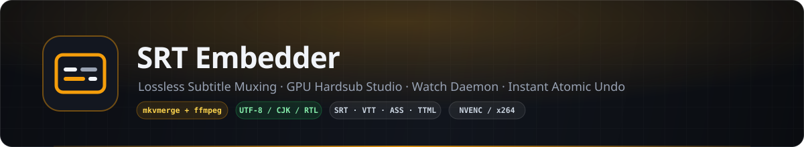
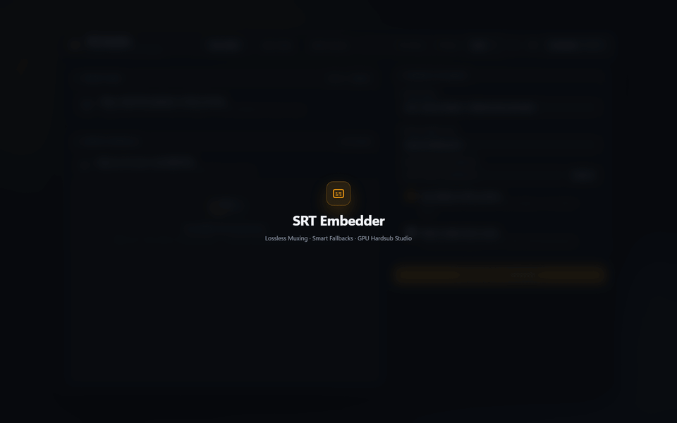
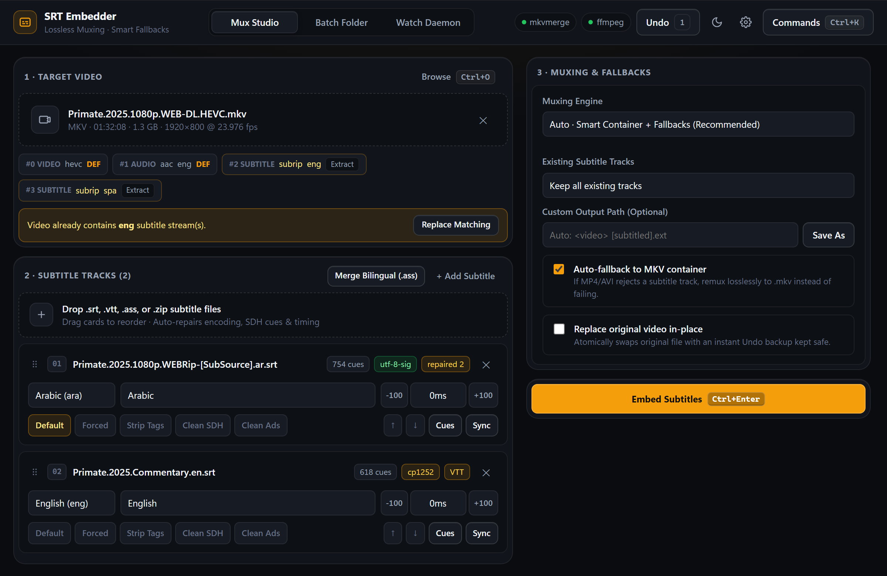
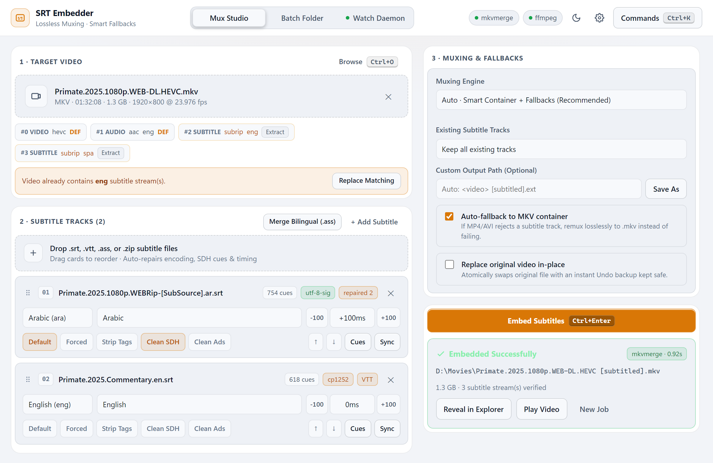
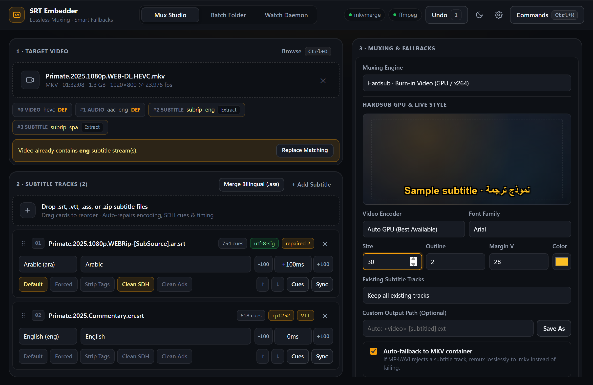
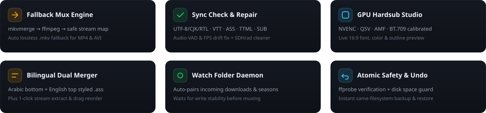

<p align="center">
  
</p>

<p align="center">
  
  
  
  
  
  
</p>

<p align="center">
  A cross-platform <strong>Desktop Studio GUI &amp; CLI</strong> for embedding <code>.srt</code>, <code>.vtt</code>, <code>.ass</code>/<code>.ssa</code>, <code>.ttml</code>/<code>.dfxp</code>, MicroDVD <code>.sub</code>, and <code>.zip</code> subtitles into videos.<br/>
  Built with lossless container muxing, GPU-accelerated burn-in, CJK/Arabic encoding &amp; BiDi repair, FPS-drift/VAD sync, MKV font attachments, Watch Daemon, and instant atomic undo.
</p>

<p align="center">
  
</p>

## Live Studio Walkthrough

<p align="center">
  
</p>

<p align="center">
  <sub>Recorded directly from the live interface · <a href="docs/media/demo.mp4">Watch full 1080p MP4 demo</a></sub>
</p>

<p align="center">
  
</p>

## Interface Gallery

<table>
  <tr>
    <td width="50%" align="center">
      <strong>Obsidian Dark Studio</strong><br/><br/>
      
    </td>
    <td width="50%" align="center">
      <strong>Daylight Studio + Verified Completion</strong><br/><br/>
      
    </td>
  </tr>
  <tr>
    <td colspan="2" align="center">
      <strong>GPU Hardsub &amp; Live 16:9 Style Preview</strong><br/><br/>
      
    </td>
  </tr>
</table>

<p align="center">
  
</p>

## Architecture & Core Capabilities

<p align="center">
  
</p>

| Capability | What It Does |
| :--- | :--- |
| **Smart Fallback Chain** | `mkvmerge` (primary lossless Matroska) → `ffmpeg` (`srt` / `mov_text`) → safe stream map (drops broken data/timecode tracks) → HTML tag stripping → automatic lossless `.mkv` remux fallback for `.mp4`/`.avi`/`.ts`. |
| **Encoding & Global Format Repair** | Auto-detects `UTF-8`, `UTF-16`, Arabic (`cp1256`), CJK (`cp932`/`Shift-JIS`, `EUC-JP`, `cp949`/`EUC-KR`, `GB18030`, `Big5`), Cyrillic (`cp1251`), Greek (`cp1253`), Hebrew (`cp1255`), Turkish (`cp1254`), and Vietnamese (`cp1258`); ingests `.srt`, `.vtt`, `.ass`/`.ssa`, `.ttml`/`.dfxp`, MicroDVD `.sub`, and `.zip` archives; supports `--fix-rtl` BiDi punctuation polish and automatic `.ttf`/`.otf`/`.ttc` font attachments in MKV. |
| **Sync Check, FPS Drift & Audio VAD** | Aligns against embedded text tracks—or falls back to FFmpeg speech-activity VAD (`silencedetect`)—and fits linear `23.976 ↔ 24 ↔ 25 fps` speed ratios + offsets (`--auto-sync`, `--speed`, 1-click UI fix). |
| **Companion Auto-Discovery & Episode Pairing** | Dropping or invoking a video automatically discovers matching subtitles in `Subs/` / `Subtitles/` / `.zip` archives; batch mode matches `S01E01` / `1x01` episode keys across differing release names. |
| **Automation Profiles, Naming & Smart Rules** | Built-in (`cinema-default`, `arabic-rtl`, `tv-compat`, `archive-inplace`) and custom profiles shared across GUI, CLI, Watch Daemon, and quick-embed; supports `default` (`[subtitled]`), `plex`, `clean`, or custom output naming (`--naming`) and foreign-audio default rules (`--prefer-sub`). |
| **Bilingual Dual-Subtitle Merger** | Merges two subtitle tracks (e.g., Arabic bottom + English top) into a single styled `.ass` track for language learning or family viewing. |
| **GPU Hardsub + Live Preview** | Probes `h264_nvenc`, `hevc_nvenc`, `h264_qsv`, `h264_amf`, and `libx264` with BT.709 color preservation and live 16:9 font/size/color/outline/margin preview. |
| **SDH/Ad Cleaner & Library Audit** | Strips `[MUSIC]`, `(SIGHS)`, `♪ notes`, `SPEAKER:`, and promo cues; audits entire media folders (`ready` / `pairable` / `missing`) with 1-click batch embedding. |
| **Watch Daemon + System Tray** | Persists processed history across restarts, auto-archives or recycles consumed subs, runs silently in `--tray` mode with desktop toasts, and supports OS sign-in startup (Windows `HKCU`, macOS LaunchAgent, Linux Autostart). |
| **Atomic Staging, Undo & Auto-Pruning** | Stages to `.tmp`, verifies output stream count via `ffprobe`, checks free disk space upfront, keeps an instant same-filesystem backup when replacing originals, and auto-prunes backups (`20` max / `14` days / `10 GB` cap). |
| **Verified Engine Bootstrapper & Updater** | Missing `ffmpeg`/`ffprobe` or `mkvmerge`? Install from **Settings ⚙** or `srt-embedder doctor --install` (SHA-256 verified Windows portable download + `winget`, macOS Homebrew, or Linux package manager guidance), and check releases via `doctor --check-update`. |

<p align="center">
  
</p>

## Quick Start

### Installation & Platform Support

Install directly from GitHub via `pip` / `pipx`, or clone and run locally:

```bash
# Lean CLI-only install (ideal for headless Linux/macOS/NAS)
pip install "git+https://github.com/BMQ-1/srt-embedder.git"

# Full Desktop Studio GUI + Tray + Recycle Bin support
pip install "srt-embedder[all] @ git+https://github.com/BMQ-1/srt-embedder.git"

# Or from a local clone (editable)
git clone https://github.com/BMQ-1/srt-embedder.git
cd srt-embedder
pip install -e ".[all]"
```

| Surface | Windows | macOS | Linux |
| :--- | :---: | :---: | :---: |
| **Core Muxer, CJK/RTL Repair, FPS/VAD Sync, Profiles, CLI** | Full | Full | Full |
| **Desktop Studio GUI (`[gui]`), Notifications, Sign-in Startup** | Full (Tray + Toast) | Full (LaunchAgent + Notification) | Full (Autostart + `notify-send`) |
| **File Manager Integration (`Settings` / `shell install`)** | Explorer (`HKCU`) | Finder Quick Action | `.desktop` + Nautilus |
| **Engine Installer & Release Binaries** | SHA-256 FFmpeg + `winget` + `.exe` | Homebrew (`brew install`) | `apt` / `dnf` / `pacman` |

Package manager manifest templates for **WinGet**, **Scoop**, and **Homebrew** live under [`packaging/`](packaging/).

> **Windows SmartScreen Note:** Standalone Windows executables (`SRT-Embedder.exe` and Setup `.exe`) are currently unsigned, so Windows Defender SmartScreen may prompt on first launch. Verify downloads against `SHA256SUMS.txt` on each GitHub Release, or install via `pip` / `pipx`.

### Desktop Studio GUI

Run `srt-embedder`, `srt-embedder-gui`, `python -m srt_embedder`, or launch **`SRT-Embedder.exe`** on Windows (from source on Windows you can also double-click **`srt-embedder.cmd`**).

You can preload a file or folder directly (`srt-embedder gui "movie.mkv"`), switch Studio UI language (`EN`, `AR` with RTL layout, `ES`, `FR`) inside **Settings ⚙**, and enable **File Manager Integration** (adds both Studio GUI and headless **Quick-Embed Subtitles (Auto Profile)** on right-click with zero admin prompt).

### Keyboard Shortcuts

| Shortcut | Action | Shortcut | Action |
| :--- | :--- | :--- | :--- |
| <kbd>Ctrl</kbd>+<kbd>K</kbd> | Open Command Palette | <kbd>Ctrl</kbd>+<kbd>Enter</kbd> | Start Muxing |
| <kbd>Ctrl</kbd>+<kbd>O</kbd> | Browse Video File | <kbd>Ctrl</kbd>+<kbd>,</kbd> | Settings &amp; Engine Doctor |
| <kbd>Esc</kbd> | Close Active Modal | `Drag & Drop` | Video / Subtitle / Folder / Reorder |

<p align="center">
  
</p>

## CLI Reference

> When running directly from a Windows checkout without `pip install`, substitute `.\srt-embedder.cmd` for `srt-embedder`.

```bash
# Verify mkvmerge, mkvextract, ffmpeg, ffprobe, GPU encoders, or install engines / check releases
srt-embedder doctor
srt-embedder doctor --install
srt-embedder doctor --check-update

# Inspect video streams or health-check/preview any supported subtitle file
srt-embedder inspect "movie.mkv"
srt-embedder inspect "subs.srt"

# Check timing sync against embedded text track or audio speech VAD
srt-embedder sync-check "movie.mkv" "subs.srt"

# Embed one or multiple subtitles, or omit subtitles to auto-discover nearby Subs/
srt-embedder embed "movie.mkv" "arabic.srt" "english.srt"
srt-embedder embed "movie.mkv" --auto-sync --naming plex --prefer-sub ara --fix-rtl

# Headless 1-step auto-pair & embed using your active profile (with desktop notification)
srt-embedder quick "movie.mkv" --notify
srt-embedder quick "./Downloads/Season 1" -r --profile arabic-rtl

# Clean SDH + translator ads, stretch FPS speed or shift +200ms, and replace original (keeps undo backup)
srt-embedder embed "movie.mkv" "subs.srt" --offset +200ms --speed 25/23.976 --clean-sdh --clean-ads --replace

# Audit a media library for ready / pairable / missing subtitles (and embed pairable in 1 shot)
srt-embedder audit "./Movies" --lang ara
srt-embedder audit "./Movies" --lang ara --embed-pairable

# Manage persistent automation profiles
srt-embedder profile list
srt-embedder profile use arabic-rtl

# Merge two subtitles into a bilingual styled .ass file & extract an embedded track
srt-embedder merge "arabic.srt" "english.srt" -o "bilingual.ass"
srt-embedder extract "movie.mkv" 2

# Batch-pair a season folder recursively or run the Watch Daemon (headless or system tray)
srt-embedder batch "./Movies/Season 1" -r --auto-sync --archive-subs
srt-embedder watch "./Downloads/Movies" -r --tray --archive-subs --auto-sync

# Manage undo backups & per-user file manager context menus
srt-embedder undo --list
srt-embedder undo --purge
srt-embedder shell install
```

<p align="center">
  
</p>

## Project Layout & Standalone Build

```text
SRT Embedder/
├── srt_embedder/
│   ├── engine.py          # Fallback muxing chain, audio-VAD sync, ASS font attach, pairing & audit
│   ├── subtitle.py        # Multi-encoding (CJK/RTL) decoder, VTT/ASS/TTML/SUB/ZIP, SDH/ad cleaner
│   ├── profiles.py        # Persistent JSON profiles, naming templates & smart language rules
│   ├── watcher.py         # Watchdog folder daemon with persistent manifest & _archived_subs cleanup
│   ├── tray.py            # Cross-platform system tray / desktop notifications & OS sign-in startup
│   ├── bootstrap.py       # SHA-256 verified FFmpeg, winget/brew engines & GitHub release update check
│   ├── undo.py            # Same-filesystem atomic backup, restore & 14d/10 GB auto-pruning store
│   ├── shell_ext.py       # Per-user file manager integration (Windows HKCU, macOS Finder, Linux)
│   ├── cli.py             # Rich terminal CLI with quick, audit, profile, --dry-run, --json
│   ├── gui.py             # pywebview desktop shell & native drag-and-drop bridge
│   └── ui/                # Feelcraft Studio UI (feelcraft.css, index.html, app.js, assets/)
├── docs/media/            # Animated SVG banners/dividers, live demo video/GIF & screenshots
├── packaging/             # WinGet, Scoop & Homebrew manifest templates
├── scripts/               # PyInstaller release builder, headless UI smoke test & showcase recorder
├── installer/             # Inno Setup (.iss) Windows installer definition
├── .github/workflows/     # CI (Ubuntu + macOS + Windows) and tagged release automation
└── tests/                 # pytest unit, CLI, BridgeApi & real-mux integration suite
```

Build the standalone Windows executables (`SRT-Embedder.exe` + `srt-embedder-cli.exe` + portable `.zip` + `SHA256SUMS.txt`):

```powershell
.\scripts\build_release.ps1
```

Tagged releases (`v*.*.*`) automatically run GitHub Actions to publish Windows portable ZIP, Inno Setup `.exe`, PyPI wheel/sdist, and `SHA256SUMS.txt` artifacts.

<p align="center">
  
</p>

<p align="center">
  <sub>MIT License · Built with Feelcraft precision</sub>
</p>
